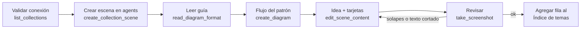

# Laboratorio de patrones de agentes con LangGraph

Espacio para aprender **un tema por carpeta**: cada patrón de workflow/agente
(Prompt chaining, Routing, ...) tiene su código en LangGraph y su diagrama
explicativo en Excalidraw+.

Explica siempre en **español**, con lenguaje simple y una analogía de la vida
real cuando el concepto sea nuevo.

## Estructura

```
c-langraph-test/
├── CLAUDE.md                 ← este archivo
├── .venv/                    ← UN solo entorno virtual para todos los temas
├── requirements.txt          ← dependencias compartidas
├── .env.example              ← UN solo .env (copiar a .env), con una sección por tema
├── langraph-test/            ← laboratorio base (notebooks, su propio CLAUDE.md)
├── prompt chaining/
│   └── prompt_chaining.py
├── routing/
│   └── routing.py
└── parallelization/
    └── parallelization.py
```

Para un tema nuevo, crea `<tema>/<tema>.py` en la raíz y agrega sus variables
`PROMPT_<NOMBRE>` como una sección nueva en el `.env.example` de la raíz (y sus
dependencias nuevas, si las hay, en el `requirements.txt` de la raíz). No mezcles temas en una misma
carpeta.

Los diagramas **no se guardan en el proyecto**: no crees archivos `.excalidraw`,
`.png` ni ningún otro archivo de diagrama. Se crean y viven solo en Excalidraw+,
a través de las herramientas `mcp__excalidraw__*`.

## Índice de temas

| Tema | Carpeta | Diagrama (Excalidraw+) |
|---|---|---|
| Workflow: Prompt chaining | `prompt chaining/` | https://app.excalidraw.com/s/QkmJ8Er8OV/9LrCOKuF1dF |
| Workflow: Routing | `routing/` | https://app.excalidraw.com/s/QkmJ8Er8OV/7uHc5d51cZO |
| Workflow: Parallelization | `parallelization/` | https://app.excalidraw.com/s/QkmJ8Er8OV/6AUr7FzfDWE |

Al terminar un tema, agrega su fila aquí.

## Código (LangGraph + LangSmith)

- Usa la API moderna de `StateGraph`, con estado explícito (`AgentState` como `TypedDict`).
  Aplican también las reglas de `langraph-test/CLAUDE.md`.
- **Los prompts y el modelo viven en LangSmith (Prompt Hub).** El código solo usa
  el identificador del prompt:
  `Client().pull_prompt(PROMPT_ID, include_model=True).invoke(variables)`.
  No escribas código de un proveedor concreto.
- Los identificadores de los prompts se leen del `.env` de la raíz (`PROMPT_<NOMBRE>`),
  y el `.env.example` documenta las variables `{...}` que espera cada prompt. Usa un
  prefijo por tema (`pc-`, `rt-`, `par-`, ...) para que no choquen.
- Cada script carga el `.env` de la raíz y fija su propio proyecto de trazas:
  `load_dotenv(Path(__file__).resolve().parent.parent / ".env")` y
  `os.environ.setdefault("LANGSMITH_PROJECT", "<tema>")`.
- Las decisiones (gate, route_decision) son **funciones normales sin LLM** dentro de
  `add_conditional_edges`.
- En cada nodo, un comentario breve de qué entra al estado y qué sale.
- Para verificar sin gastar tokens, reemplaza `cargar_prompt` por un `RunnableLambda`
  falso y ejecuta el grafo.
- Ejecución (desde la raíz): `.venv/bin/python <tema>/<tema>.py "<input>"`.
- Ver los grafos en LangGraph Studio (desde la raíz):
  ```bash
  .venv/bin/langgraph dev --port 2025
  ```
  Luego abre https://smith.langchain.com/studio/?baseUrl=http://127.0.0.1:2025 y elige
  el grafo arriba a la izquierda. Se detiene con `Ctrl+C`. Usa el `langgraph.json` de
  la raíz; registra ahí el `app` de cada tema nuevo.
- Crear/actualizar el entorno: `uv venv --python 3.13 .venv && uv pip install --python .venv/bin/python -r requirements.txt`.

## LangSmith (MCP)

- El servidor está en `.mcp.json` del proyecto: `langsmith` → `https://api.smith.langchain.com/mcp`
  (MCP remoto oficial), con `X-Api-Key: ${LANGSMITH_API_KEY}`. La key se lee de una variable
  de entorno del shell, así que el archivo no lleva ningún secreto.
- Herramientas: `mcp__langsmith__*` (`list_prompts`, `get_prompt_by_name`, `push_prompt`,
  `fetch_runs`, `list_projects`, ...). Úsalas para revisar prompts y trazas de cada tema.
- Si no aparecen en la sesión, pide al usuario que agregue `export LANGSMITH_API_KEY="<API_KEY>"`
  a su `~/.zshrc`, apruebe el servidor del proyecto y reinicie la sesión. Nunca manejes tú
  la API key.

## Diagramas en Excalidraw+

### Al inicio de cada sesión que requiera dibujar

Antes de dibujar, **valida la conexión con Excalidraw+**:

1. Comprueba que existen las herramientas `mcp__excalidraw__*` (cárgalas con ToolSearch).
2. Llama a `mcp__excalidraw__list_collections` y confirma que aparece la colección **agents**.
3. Si no hay conexión:
   - El servidor está en `.mcp.json` del proyecto: `excalidraw` → `https://api.excalidraw.com/api/v1/mcp`,
     con `Authorization: Bearer ${EXCALIDRAW_API_KEY}`. La key se lee de una variable de
     entorno del shell, así que el archivo no lleva ningún secreto.
   - Ejecuta `claude mcp get excalidraw` para ver su estado.
   - Si falla la autenticación, pide al usuario que cree una API key personal en Excalidraw+
     y que agregue `export EXCALIDRAW_API_KEY="<API_KEY>"` a su `~/.zshrc` (no al `.env`
     del proyecto: ese solo lo leen los scripts de Python). Nunca manejes tú la API key.
   - Si está configurado pero no hay herramientas en la sesión, pide aprobar el servidor
     del proyecto y reiniciar la sesión.
   - No sigas con el diagrama hasta tener conexión. El código del tema sí se puede avanzar.

### Dónde dibujar

- Workspace `QkmJ8Er8OV`. Cada tema va en una **escena nueva** dentro de la colección
  **agents** (`5nnXUNpfsYs`), con el nombre del tema, por ejemplo `Workflow: Routing`.
- Crea la escena con `create_collection_scene` (`pinned: false`).
- No escribas en escenas de otras colecciones (aws, projects, closius). Por ejemplo,
  `3dM90LOL7oL` es un diagrama de trabajo del PO.

### Pasos para dibujar



### Plantilla de cada escena (mantener siempre esta estructura)

1. **Título**: `Workflow: <Tema>` o `Agent: <Tema>`, en tamaño grande (fontSize 44).
2. **Flujo del diagrama**: hecho con `create_diagram`. Input y Output como `terminal`,
   las llamadas al LLM como `service`, las decisiones como `decision`, y los cortes
   o errores como `warning`. Etiqueta solo las flechas de decisión, por ejemplo
   Pass / Fail o las categorías del router.
3. **Idea**: una o dos líneas debajo del flujo que expliquen el patrón.
4. **Tarjetas**:
   - **¿Cuándo usarlo?** (azul `#e7f5ff` / `#228be6`)
   - **Ejemplos** (amarillo `#fff9db` / `#f08c00`): uno de negocio real y el del tutorial de LangGraph.
   - **En LangGraph** (verde `#ebfbee` / `#2f9e44`, fuente de código `fontFamily: 8`): las líneas clave del grafo.
   - **Comparativas** (violeta `#f3f0ff` / `#7950f2`): en qué se parece y en qué se
     diferencia de los patrones ya vistos (por ejemplo, Routing vs Gate, o Parallelization
     vs Prompt chaining y Routing), y sus variantes si las tiene.
5. Revisa con `take_screenshot` que no haya flechas o etiquetas solapadas ni texto
   pegado al borde de las tarjetas.

## Próximos temas sugeridos

Workflow: Orchestrator-workers →
Workflow: Evaluator-optimizer → Agent (bucle con herramientas).
