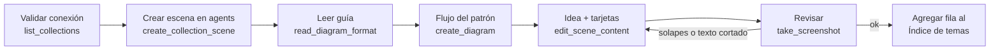

# Laboratorio de patrones de agentes con LangGraph

Espacio para aprender **un tema por carpeta**: cada patrón de workflow/agente
(Prompt chaining, Routing, ...) tiene su código en LangGraph y su diagrama
explicativo en Excalidraw+.

Explica siempre en **español**, con lenguaje simple y una analogía de la vida
real cuando el concepto sea nuevo.

## Estructura

```
c-langraph-test/
├── CLAUDE.md                 ← este archivo
├── langraph-test/            ← laboratorio base (.venv, notebooks, su propio CLAUDE.md)
├── prompt chaining/
│   ├── prompt_chaining.py
│   ├── .env.example
│   └── requirements.txt
├── routing/
│   ├── routing.py
│   ├── .env.example
│   └── requirements.txt
└── parallelization/
    ├── parallelization.py
    ├── .env.example
    └── requirements.txt
```

Para un tema nuevo, crea `<tema>/` en la raíz con los mismos archivos:
`<tema>.py`, `.env.example` y `requirements.txt`. No mezcles temas en una misma
carpeta.

Los diagramas **no se guardan en el proyecto**: no crees archivos `.excalidraw`,
`.png` ni ningún otro archivo de diagrama. Se crean y viven solo en Excalidraw+,
a través de las herramientas `mcp__excalidraw__*`.

## Índice de temas

| Tema | Carpeta | Diagrama (Excalidraw+) |
|---|---|---|
| Workflow: Prompt chaining | `prompt chaining/` | https://app.excalidraw.com/s/QkmJ8Er8OV/9LrCOKuF1dF |
| Workflow: Routing | `routing/` | https://app.excalidraw.com/s/QkmJ8Er8OV/7uHc5d51cZO |
| Workflow: Parallelization | `parallelization/` | https://app.excalidraw.com/s/QkmJ8Er8OV/6AUr7FzfDWE |

Al terminar un tema, agrega su fila aquí.

## Código (LangGraph + LangSmith)

- Usa la API moderna de `StateGraph`, con estado explícito (`AgentState` como `TypedDict`).
  Aplican también las reglas de `langraph-test/CLAUDE.md`.
- **Los prompts y el modelo viven en LangSmith (Prompt Hub).** El código solo usa
  el identificador del prompt:
  `Client().pull_prompt(PROMPT_ID, include_model=True).invoke(variables)`.
  No escribas código de un proveedor concreto.
- Los identificadores de los prompts se leen del `.env` (`PROMPT_<NOMBRE>`), y cada
  `.env.example` documenta las variables `{...}` que espera cada prompt.
- Las decisiones (gate, route_decision) son **funciones normales sin LLM** dentro de
  `add_conditional_edges`.
- En cada nodo, un comentario breve de qué entra al estado y qué sale.
- Para verificar sin gastar tokens, reemplaza `cargar_prompt` por un `RunnableLambda`
  falso y ejecuta el grafo.
- Ejecución (desde la carpeta del tema, para que lea su `.env`):
  `../langraph-test/.venv/bin/python <tema>.py "<input>"`

## Diagramas en Excalidraw+

### Al inicio de cada sesión que requiera dibujar

Antes de dibujar, **valida la conexión con Excalidraw+**:

1. Comprueba que existen las herramientas `mcp__excalidraw__*` (cárgalas con ToolSearch).
2. Llama a `mcp__excalidraw__list_collections` y confirma que aparece la colección **agents**.
3. Si no hay conexión:
   - Ejecuta `claude mcp get excalidraw`. El servidor es `https://api.excalidraw.com/api/v1/mcp`,
     con `Authorization: Bearer <API_KEY>`.
   - Si no está configurado, pide al usuario que cree una API key personal en Excalidraw+
     y que ejecute `claude mcp add --transport http excalidraw https://api.excalidraw.com/api/v1/mcp --header "Authorization: Bearer <API_KEY>"`.
     Nunca manejes tú la API key.
   - Si está configurado pero no hay herramientas en la sesión, pide reiniciar la sesión.
   - No sigas con el diagrama hasta tener conexión. El código del tema sí se puede avanzar.

### Dónde dibujar

- Workspace `QkmJ8Er8OV`. Cada tema va en una **escena nueva** dentro de la colección
  **agents** (`5nnXUNpfsYs`), con el nombre del tema, por ejemplo `Workflow: Routing`.
- Crea la escena con `create_collection_scene` (`pinned: false`).
- No escribas en escenas de otras colecciones (aws, projects, closius). Por ejemplo,
  `3dM90LOL7oL` es un diagrama de trabajo del PO.

### Pasos para dibujar



### Plantilla de cada escena (mantener siempre esta estructura)

1. **Título**: `Workflow: <Tema>` o `Agent: <Tema>`, en tamaño grande (fontSize 44).
2. **Flujo del diagrama**: hecho con `create_diagram`. Input y Output como `terminal`,
   las llamadas al LLM como `service`, las decisiones como `decision`, y los cortes
   o errores como `warning`. Etiqueta solo las flechas de decisión, por ejemplo
   Pass / Fail o las categorías del router.
3. **Idea**: una o dos líneas debajo del flujo que expliquen el patrón.
4. **Tarjetas**:
   - **¿Cuándo usarlo?** (azul `#e7f5ff` / `#228be6`)
   - **Ejemplos** (amarillo `#fff9db` / `#f08c00`): uno de negocio real y el del tutorial de LangGraph.
   - **En LangGraph** (verde `#ebfbee` / `#2f9e44`, fuente de código `fontFamily: 8`): las líneas clave del grafo.
   - **Comparativas** (violeta `#f3f0ff` / `#7950f2`): en qué se parece y en qué se
     diferencia de los patrones ya vistos (por ejemplo, Routing vs Gate, o Parallelization
     vs Prompt chaining y Routing), y sus variantes si las tiene.
5. Revisa con `take_screenshot` que no haya flechas o etiquetas solapadas ni texto
   pegado al borde de las tarjetas.

## Próximos temas sugeridos

Workflow: Orchestrator-workers →
Workflow: Evaluator-optimizer → Agent (bucle con herramientas).
